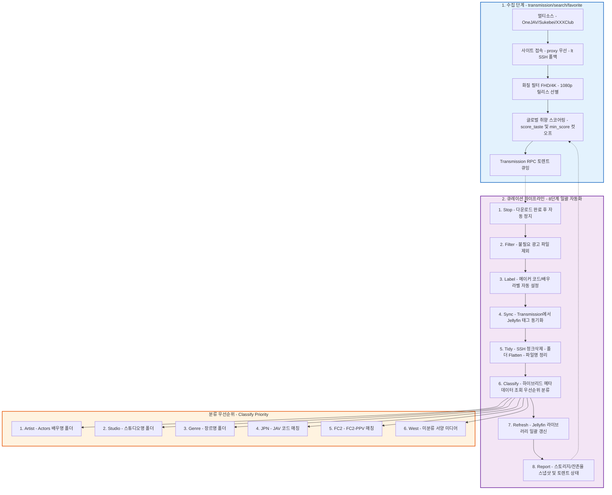

# Architecture & Workflow (아키텍처 및 워크플로우 설계)

Meridian-X의 설계 철학과 2단계 운영 아키텍처(수집 단계 및 8단계 큐레이션 파이프라인)를 설명합니다.

---

## 1. 2단계 운영 아키텍처 (2-Phase Architecture)

수집(Ingestion)은 정기 RSS(`transmission`)와 즐겨찾기 수동 수집(`meridian favorite`, 사용자 등록 배우/tag 신작 무조건 수집) 이원화되어 있다.

### 사이트 접속 우회 (Egress)

일부 소스(onejav 등)는 한국 ISP 차단목록에 등재되어 KR egress(lt, heritage)에서 TLS reset·URL 차단이 발생한다. 소스 fetch는 brla에 상주하는 gluetun(Surfshark Singapore WireGuard) HTTP 프록시를 우선 경유하고, 실패 시 lt 원격 curl, 최후 로컬 직접 접근으로 폴백한다.

onejav는 추가로 사이트 전체에 Cloudflare JS challenge가 걸려 있어, brla의 FlareSolverr(gluetun egress 경유 Chromium)로 RSS·페이지를 받고 발급된 `cf_clearance` 쿠키와 User-Agent를 그대로 실어 gluetun 프록시에서 `.torrent`를 다운로드한다. `cf_clearance`는 egress IP·UA에 바인딩되므로 FlareSolverr와 `proxy`는 같은 gluetun을 사용해야 한다.

---

## 2. 8단계 큐레이션 파이프라인 상세

1. **Stop After Download**: 다운로드가 끝난 토렌트를 자동 정지하여 리소스 낭비를 방지합니다.
2. **Filter**: 불필요한 텍스트 파일, URL 바로가기, 샘플 영상 등 광고 파일을 `unwanted` 처리합니다.
3. **Label**: 토렌트 이름에서 메이커 코드나 배우명을 추출하여 Transmission 라벨을 부여합니다.
4. **Sync**: 부여된 라벨을 Jellyfin 태그로 동기화하여 미디어 서버 검색성을 높입니다.
5. **Tidy**: SSH 원격 연결을 통해 부산물 정크를 삭제하고, 루트 영상 폴더 및 `FC2/` 내 미지정 하위 폴더를 Flatten하며, 파일명의 상업용 광고 접두사를 정중히 정화합니다.
6. **Classify**: Jav321/JavBus, OneJAV, StashDB GraphQL API를 하이브리드로 조회하여 배우 폴더(`Actors/{배우}/`)를 최우선으로 스튜디오, 장르, JPN, FC2, West 폴더로 안전하게 분류 이동합니다.
7. **Jellyfin Refresh**: 파일 이동 사항을 Jellyfin 미디어 라이브러리에 일괄 반영합니다.
8. **System Report**: 최종 스토리지 용량, 이력 대비 실제 잔존율(`retention_stats` DB 스냅샷 갱신) 및 토렌트 데몬 상태를 브리핑합니다.

---

## 3. 스마트 릴리스 선별 및 글로벌 취향 스코어링

동일한 에피소드가 여러 화질 및 릴 그룹으로 배포될 때 `deduplicate_releases`가 최고 품질 단일 릴리스를 선별하고, 이후 `score_taste`가 전 소스 후보를 글로벌 정렬합니다:

- **해상도 우선순위**: 1080p(FHD, +1000점) > 2160p(4K, +500점) > 720p/SD (제외 대상)
- **릴 그룹 안정성**: WRB / XC (+300점) > TRB (+200점) > P2P (+100점)
- **잔존율 기반 취향 스코어링 (`score_taste`)**: `retention_stats`(실제 디스크 잔존 파일 수) + 메타데이터 캐시(`jav_metadata`/`west_metadata`)를 결합해 배우(`+30 + log2(1+kept)*10`), 스튜디오/`FC2`(`+10 + log2(1+kept)*5`), JAV 메이커 프리픽스(`log2(1+kept)*4`) 점수를 산출하며 `collection.scoring.min_score` 미만 항목은 자동 스킵합니다(`meridian favorite` 제외).
